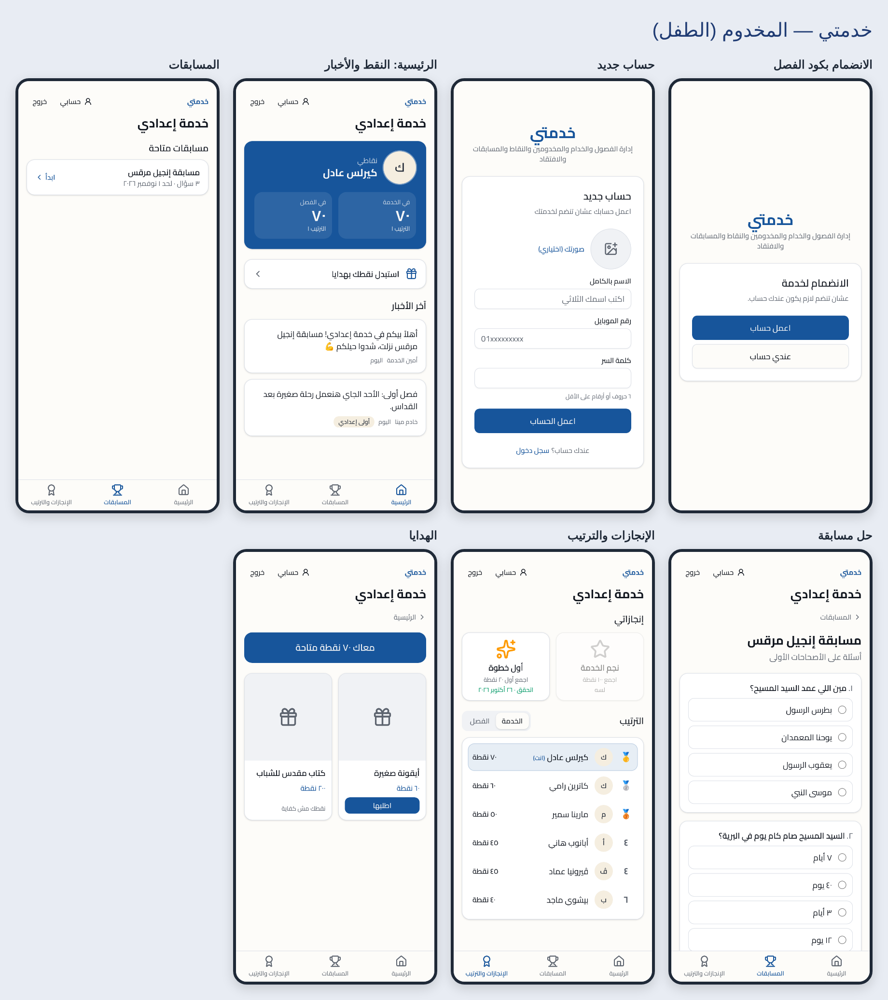

# خدمتي — Sunday school services manager

Multi-church PWA for managing church youth services. The full product and technical spec is in [`CLAUDE.md`](./CLAUDE.md); deployment steps are in [`DEPLOY.md`](./DEPLOY.md).



More: [service admin](docs/screenshots/2-admin.png) · [servant, church admin, super admin](docs/screenshots/3-servant-church.png)

## Stack

Next.js 16 (App Router, TypeScript strict) · Tailwind CSS v4 + shadcn/ui (RTL) · Supabase (Auth, Postgres + RLS) · Serwist PWA.

## Getting started

```bash
npm install
npx supabase start              # local Supabase (needs Docker)
cp .env.example .env.local      # paste the URL + publishable key printed by `supabase start`
npm run dev
```

Useful scripts:

| Script | What it does |
|---|---|
| `npm run db:reset` | Recreate the local DB from `supabase/migrations` (+ seed) |
| `npm run db:types` | Regenerate `lib/database.types.ts` from the local DB |
| `npm run test:db` | RLS test suite (pgTAP, `supabase/tests/database`) |
| `npm run test:e2e` | Playwright: join-by-QR, quiz → gift → approval, servant visit (needs a fresh `db reset` + `build`; starts `npm start` if nothing is on :3000) |
| `npm run typecheck` / `npm run lint` | TypeScript / ESLint |
| `npm run icons` | Regenerate PWA icons in `public/icons` |

## Auth: phone + password without SMS

Kids sign up with **name + Egyptian mobile + password**. To avoid needing an SMS provider, the phone is normalized to E.164 (`+201012345678`, accepts `01…`, `+20…`, `0020…`, Arabic-Indic digits) and stored in Supabase Auth under a synthetic email `201012345678@phone.khedma.app`. The real phone goes into `profiles.phone`.

Login accepts either a phone (mapped the same way) or a real email (for admin accounts created with one).

**Hosted Supabase project:** turn **off** Auth → Providers → Email → *Confirm email*, otherwise phone signups wait for a confirmation mail that can never arrive.

## Seed accounts (local only)

`supabase db reset` loads `supabase/seed.sql`. Password for all: `password123`.

| Role | Phone |
|---|---|
| Super admin | 01000000001 |
| Church admin | 01000000002 |
| Service admin (خدمة إعدادي) | 01000000003 |
| Servants | 01100000001, 01100000002 |
| Served ×6 | 01200000001 … 01200000006 |

Join codes (one per class): `EADY1A` (أولى إعدادي), `EADY2B` (تانية إعدادي). Try `/join?code=EADY1A`.

## Data access model

Every table has RLS with default deny; see `supabase/migrations/*_rls_*.sql`. Things to know when writing queries:

- **`profiles.phone` and `competition_questions.correct_index` are not selectable** (column grants), so `select("*")` on those tables fails. List the columns. Read phones with `rpc("visible_phone", { p_user })` (self, admins over that user, and their assigned servant only) and answer keys with `rpc("competition_answer_key", { p_competition })` (service admins only).
- **No direct writes** to `points_ledger`, `visits`, `prep_attendance`, `competition_entries`, `gift_redemptions`, `user_achievements`. They are written by `SECURITY DEFINER` RPCs that also add the matching ledger entry: `award_points(_many)`, `reverse_points`, `log_visit`, `check_in_prep`, `mark_prep_attendance`, `submit_competition`, `redeem_gift`, `decide_redemption`. All ledger rows go through the internal `ledger_add`.
- **The ledger always matches the activity:** deleting a visit, an attendance or a prep session inserts reversing entries (trigger); gift points are debited on approval and refunded if an approved request is rejected.
- **Achievements engine:** criteria `{"type": "points_total" | "competitions_count" | "visits_count", "gte": N}`, evaluated by triggers after points, quiz entries and visits, and for everyone when an achievement is created. Earned achievements are permanent.
- Leaderboards: `v_service_leaderboard` / `v_class_leaderboard`, filtered to services the caller belongs to.
- Storage paths: `avatars/<user_id>/…`, `service-media/<service_id>/…`. Both buckets are private, so use signed URLs.

## Screens

| Route | Who | What |
|---|---|---|
| `/` | everyone | "اختار الخدمة" picker; skips straight to the only/last-picked place (`?pick=1` to choose again) |
| `/profile` | everyone | name and photo |
| `/join?code=…`, `/scan` | anyone | join a class by QR or typed code (logged out → signup → back to join) |
| `/admin` | super admin | churches CRUD; appoint/remove church admins (search users by name or phone) |
| `/church/[churchId]` | church admin | services CRUD, service admins, servants pool |
| `/s/[serviceId]/manage` | service admin | dashboard · classes · members · join codes/QR · points (ledger, awards, corrections, leaderboards, rules) · visitation (assignments, overdue, log) · prep sessions/attendance · competitions · posts · gifts/requests · achievements |
| `/s/[serviceId]/servant` | servant | home (points, rank, next prep + check-in) · مخدوميني (log visits, call) · التحضير · الترتيب |
| `/s/[serviceId]/home` | served | home (points, timeline, gifts) · competitions · achievements + leaderboard |

Church admins find people by **exact phone number only** (`find_user_by_phone`), so they can't browse the platform's users. Only super admins get a name/phone search (`search_users`).

## Project layout

```
app/(auth)/          login, signup + server actions
app/serwist/[path]/  service worker route (Serwist + Turbopack)
app/sw.ts            service worker source
app/manifest.ts      PWA manifest (ar, rtl)
components/ui/       shadcn/ui components
lib/supabase/        browser, server and proxy clients
lib/strings.ts       all Arabic UI strings
proxy.ts             session refresh + optimistic auth redirect (Next 16's name for middleware.ts)
supabase/migrations/ SQL migrations (schema, RLS, RPCs per phase)
supabase/tests/      pgTAP RLS/RPC tests
e2e/                 Playwright tests
```

CI (`.github/workflows/ci.yml`) runs lint, typecheck, build, the pgTAP suite and Playwright against a local Supabase on every push/PR.

## Join codes

One code per class (owner decision, phase 4): scanning puts the kid straight into that class as an active member. Codes are 6 characters without look-alikes (no 0/O, 1/I/L), can expire at the end of a chosen day (Cairo time), can be paused, and can be regenerated (the old QR stops working). Scanning a code for a service you're already in does nothing; only the service admin moves kids between classes. A kid the admin removed can't rejoin on their own.

The QR encodes `NEXT_PUBLIC_SITE_URL/join?code=…` (falls back to the request host), so set `NEXT_PUBLIC_SITE_URL` in production. The scanner's fallback decoder for iOS (`zxing_reader.wasm`) is copied into `public/zxing` on `postinstall` and served from our own origin.

## Notes

- **Photos** are resized in the browser before upload (`components/image-input.tsx`), stored privately and shown via short-lived signed URLs.
- **Privacy on shared phones:** the service worker caches only static build assets and icons. Pages, RSC payloads and Supabase calls are always network-only, and an offline fallback page is shown instead.
- `cacheComponents` is off: nearly every page is per-user, so the classic dynamic rendering model is simpler here.
- shadcn components were added by hand (the registry was unreachable from the build environment). `components.json` is set up, so `npx shadcn add <component>` works normally from now on.
