# خدمتي — المخطط التفصيلي للتطبيق

نفس الرسومات اللي في [khedma-flowchart.pdf](khedma-flowchart.pdf)، مكتوبة بـ Mermaid عشان تتعدّل بسهولة (GitHub بيعرضها رسومات).

## التطبيق كله في صفحة واحدة

نفس [khedma-flowchart-full.pdf](khedma-flowchart-full.pdf).

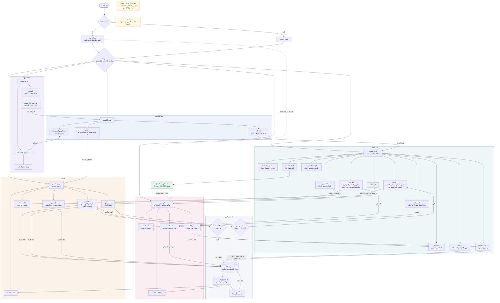

## ١. الدخول ومين بيروح فين

أول ما المستخدم يفتح التطبيق لحد ما يوصل لواجهته

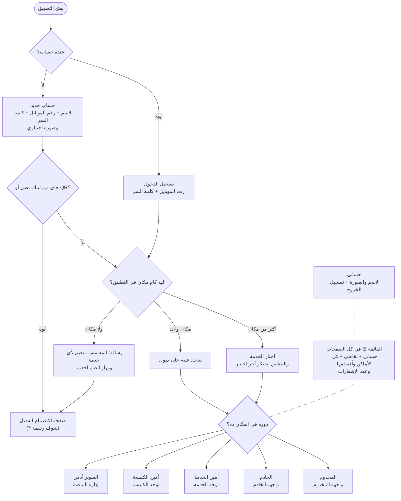

## ٢. الهيكل والصلاحيات

كل مستوى بيدير اللي تحته بس، والصلاحيات متطبقة جوه قاعدة البيانات نفسها

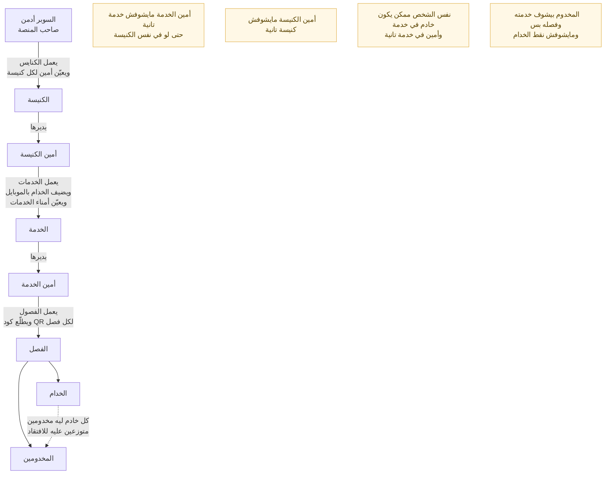

## ٣. انضمام المخدوم بكود الفصل (QR)

كل فصل ليه كود، والمخدوم بيدخل الفصل على طول

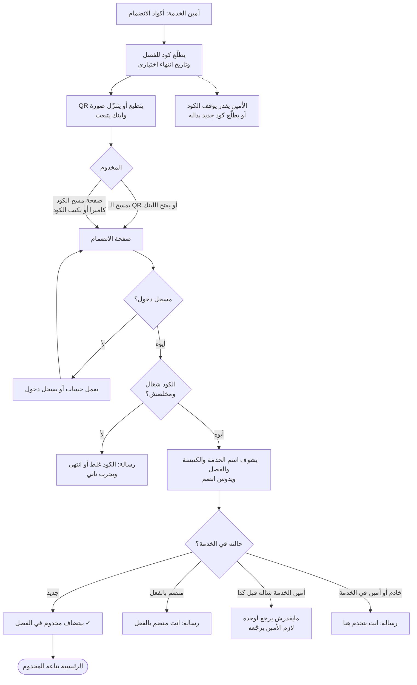

## ٤. السوبر أدمن وأمين الكنيسة

إدارة الكنايس والخدمات والخدام

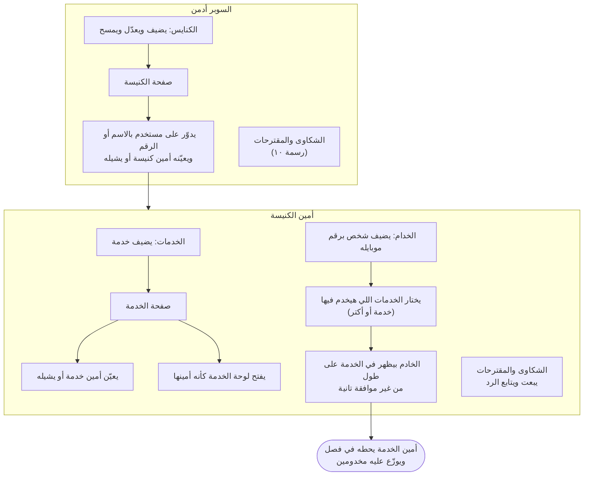

## ٥. لوحة أمين الخدمة

١٣ قسم، وعدد الإشعارات بيظهر على الأقسام اللي محتاجة رد

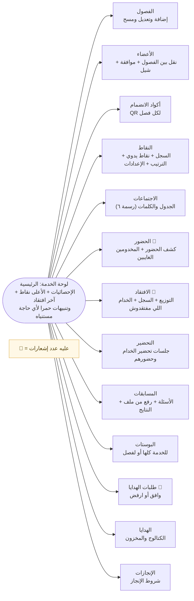

## ٦. الاجتماعات والحضور وتنبيه الغياب

الأمين يجدول، والخدام يسجلوا الحضور، والتطبيق ينبّه على الغياب

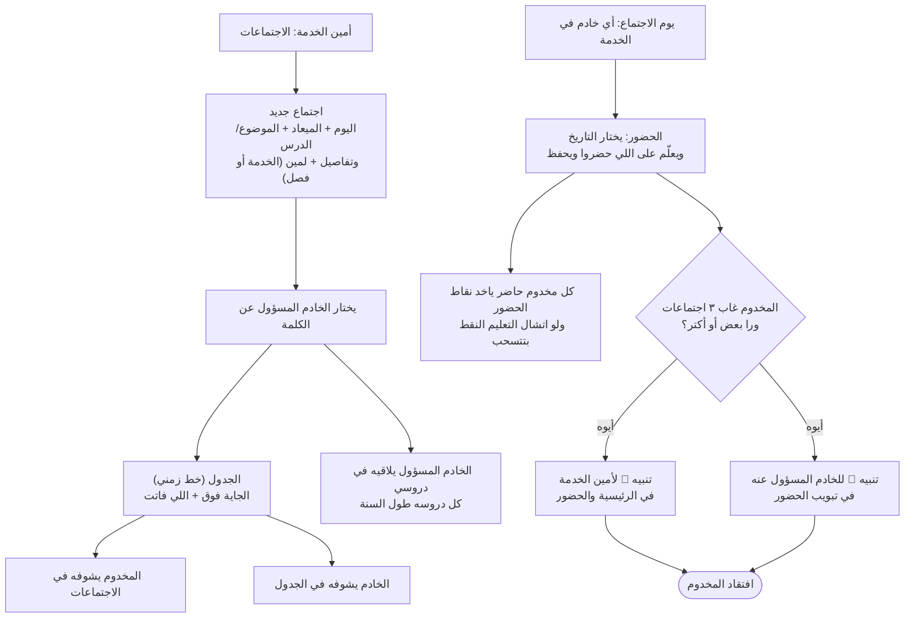

## ٧. الافتقاد والتحضير

شغل الخادم مع مخدوميه، وتحضيره هو

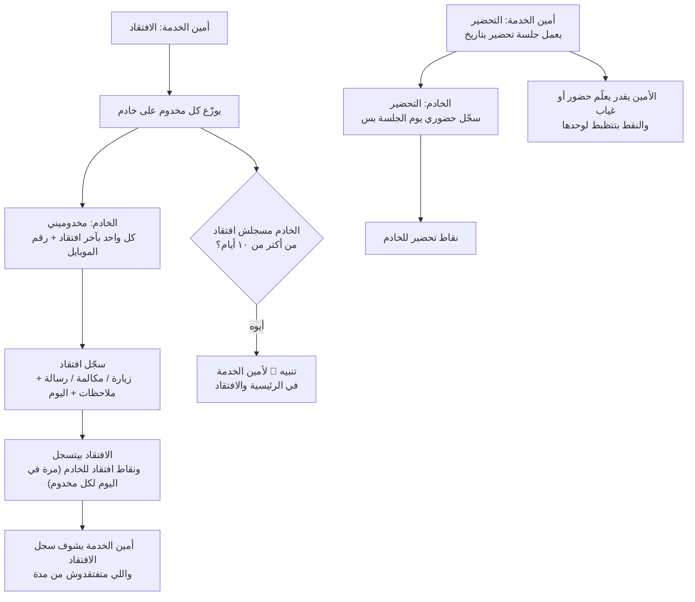

## ٨. المسابقات

من كتابة الأسئلة لحد ما النقط توصل لمجموع المخدوم

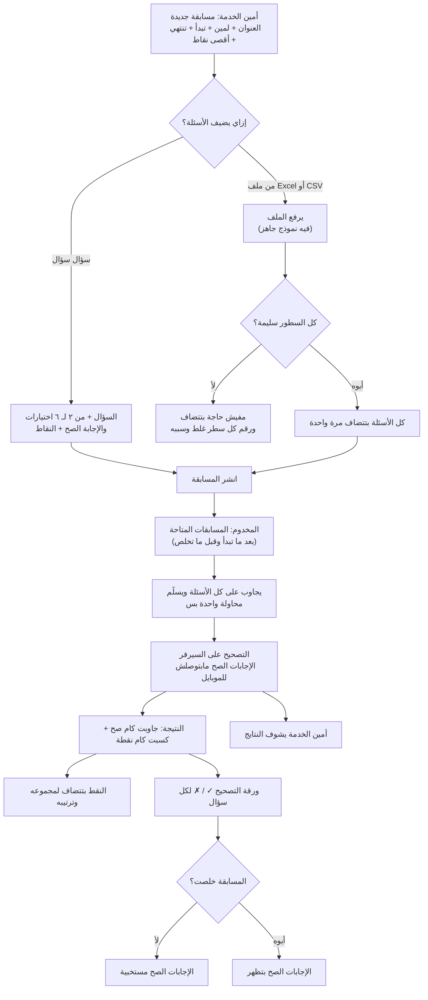

## ٩. النقاط والهدايا والإنجازات

سجل نقاط ثابت: أي تصحيح بيتعمل بقيد عكسي، مفيش تعديل ولا مسح

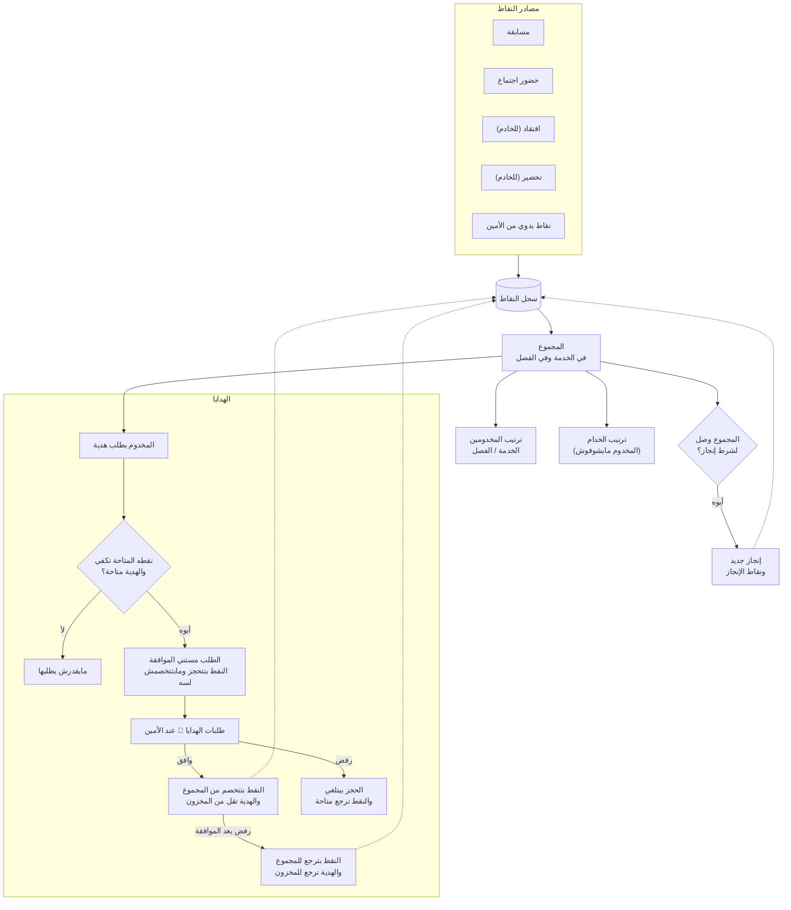

## ١٠. الشكاوى والمقترحات

بين أمين الكنيسة والسوبر أدمن بس

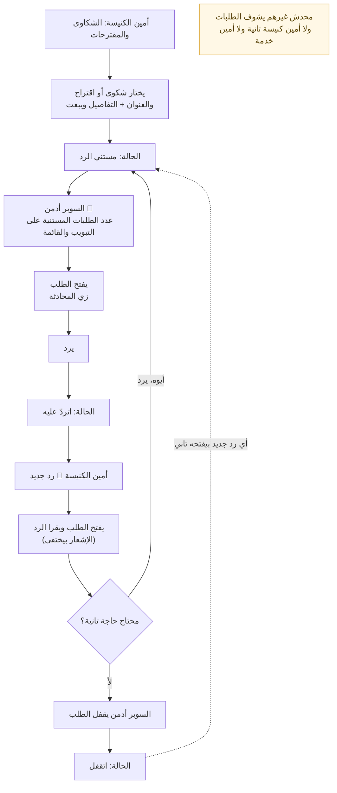

## ١١. الإشعارات (الدواير الحمرا)

العدد بيظهر على القسم نفسه، وعلى زرار القائمة ☰، وفي القائمة الجانبية

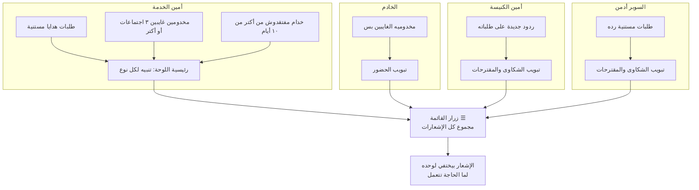
